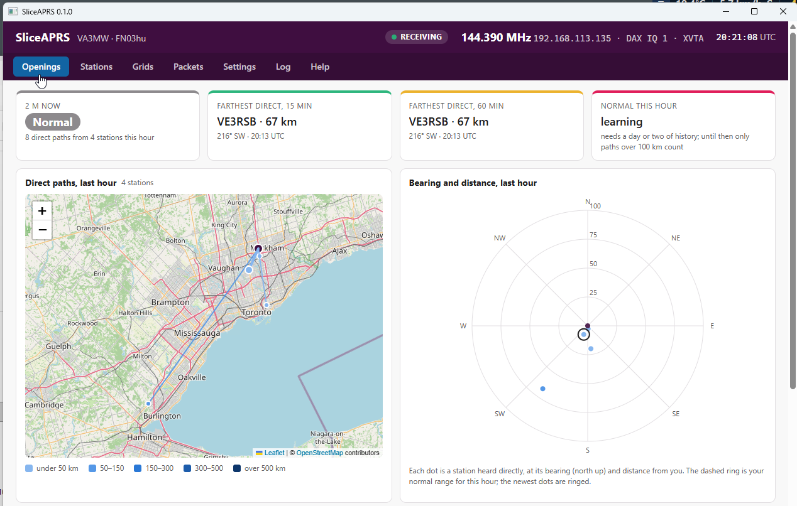
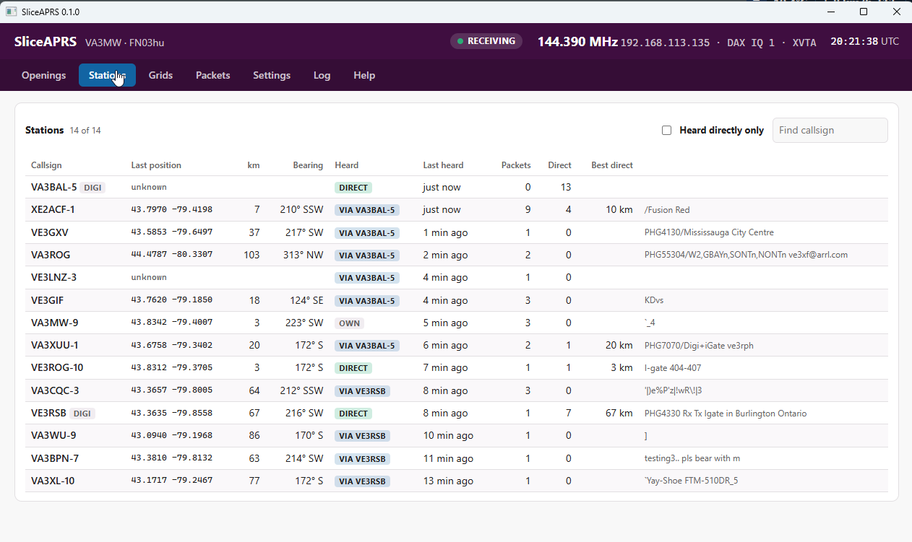

# SliceAPRS

SliceAPRS listens to APRS on 2 m through a FlexRadio FLEX-6000 and uses the packets to spot 2 m path openings (tropo and other enhancements) for 2 m DX.

APRS stations beacon their positions all the time, so they make a dense network of 2 m beacons. When the band opens, you start to hear stations **directly** from much farther away than usual. SliceAPRS works out which station's signal actually reached your antenna, learns your normal range, and flags openings.

Receive only: it never transmits. SmartSDR and DAX do not need to be running.

**User guide and downloads:** https://va3mw.github.io/SliceAPRS/





## How it works

- Connects straight to the radio as a GUI client (TCP 4992), creates its own panadapter at 144.390 MHz (a setting; 144.800 in Europe) and a 24 kHz DAX IQ stream (channel 2 by default, so it doesn't clash with FlexWSPR on channel 1). Before taking a DAX IQ channel it checks that no other program is using it. With a 2 m transverter (FLEX-6600/6400), leave the receive antenna on the radio's choice and SliceAPRS uses the XVTA port, or pick the antenna in Settings.
- Decodes in pure Go: FM demodulation, 1200 baud AFSK with tone-normalising correlators, several slicers and a digital PLL (the Dire Wolf approach), HDLC with bit unstuffing and the FCS check, AX.25 with the digipeater path and H bits, and APRS (plain, compressed and Mic-E positions, objects, items, status, weather, messages). Each packet's signal level is measured from the IQ.
- **Who was heard:** the last digipeater with its H bit set, or the sender if no digipeater has repeated it. A relayed packet is measured to the digipeater (whose position is learned from its own beacons), never to the original sender. Internet (third-party, TCPIP), satellite/ISS, untraced aliases and your own call never count. Position jumps are held until a second report agrees.
- **Normal range:** per UTC hour, the 90th percentile of each station's farthest direct distance per hour over 14 days. **Openings:** several stations beyond normal within 30 minutes, or any direct path over a set distance (300 km to start), with strength, direction and start/end, logged.

## GUI

The program serves its own web page; the desktop app (Wails) shows the same page in a window and serves it on the web port too. Tabs: Openings (status, farthest direct stations, map, polar plot, 24 h against normal, openings log), Stations, Grids (grid squares heard directly), Packets, Settings, Log, Help. Map tiles come from OpenStreetMap through SliceAPRS, which caches them in the data folder.

## Running

```
sliceaprs                      headless, web page on 127.0.0.1:8081 (Windows) or :8081 (Linux)
sliceaprs-gui                  desktop app (Windows)
sliceaprs -decode file.wav     decode a recording (1 channel audio, 2 channels IQ) and print counts
sliceaprs -replay file.wav     run everything on a recording instead of the radio
sliceaprs -record-iq out.wav   record the radio's DAX IQ while running
aprsgen -o test.wav            make a test recording (locals, digipeated far station, traps, an opening)
```

History (daily packet logs, direct paths, openings, stations) is kept in the data folder and never deleted by SliceAPRS.

## Building

`./build.sh` or `.\build.ps1` builds the headless program for Linux amd64/arm64/arm (Raspberry Pi) and Windows, and the Windows desktop app (`go build -tags desktop,production -ldflags "-H windowsgui" ./cmd/sliceaprs-gui`).

## License

MIT. Copyright (c) 2026 Michael, VA3MW. Written by Michael, VA3MW, and Claude (Anthropic).
